

**Um relatório diário de vendas gerado por duas funções Lambda, enviado por e-mail e disparado por agenda** ☕📊📧

---

## 📌 Sobre o projeto

Neste laboratório do **AWS re/Start**, construí o fluxo de um **relatório de análise de vendas** de uma cafeteria, usando **duas funções AWS Lambda** que trabalham juntas:

| ⚡ Função | 📝 O que faz |
|---|---|
| **`salesAnalysisReportDataExtractor`** | Conecta ao banco **MySQL** (em uma instância EC2 dentro de uma VPC) e extrai os dados dos pedidos |
| **`salesAnalysisReport`** | Lê as credenciais no **Parameter Store**, **invoca a função extratora**, formata o relatório e o publica em um tópico do **SNS**, que envia o **e-mail** |

O relatório é disparado **automaticamente por agenda**, com uma regra do **Amazon EventBridge** (expressão cron).

O laboratório também envolveu **troubleshooting**: a função extratora deu *timeout* por causa de uma **porta bloqueada**, e a função do relatório falhou por um **ARN de tópico incorreto**.

---

## 🎯 Objetivos

- ✅ Entender os **perfis IAM** e as permissões de cada função Lambda
- ✅ Criar uma **camada (layer)** do Lambda para uma biblioteca externa (PyMySQL)
- ✅ Criar uma função Lambda **dentro de uma VPC** para acessar um banco de dados
- ✅ Diagnosticar e corrigir um **timeout** pelos logs e pelo grupo de segurança
- ✅ Criar um **tópico SNS** com assinatura de e-mail
- ✅ Criar uma função Lambda pela **AWS CLI**
- ✅ Configurar **variáveis de ambiente**
- ✅ Agendar a execução com um **gatilho do EventBridge**

---

## 🗺️ Arquitetura

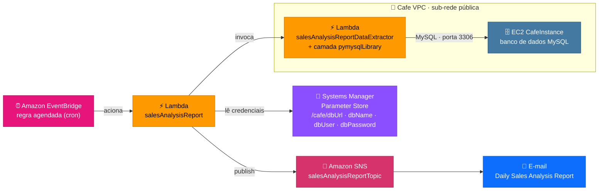

---

## 🧰 Serviços utilizados

| 🎨 Categoria | 🔧 Serviço | 📝 Função no projeto |
|:---:|:---:|---|
| ⚡ Compute | **AWS Lambda** | Duas funções em Python, uma camada e o fluxo do relatório |
| 🔐 Segurança | **AWS IAM** | Perfis `salesAnalysisReportRole` e `salesAnalysisReportDERole` |
| 🔑 Configuração | **Systems Manager Parameter Store** | Guarda as credenciais do banco de dados |
| 🛡️ Rede | **VPC e Security Group** | Conexão da função com o banco; regra da porta 3306 |
| 🗄️ Banco | **MySQL em EC2** | Armazena os pedidos da cafeteria |
| 📣 Mensageria | **Amazon SNS** | Entrega o relatório por e-mail |
| ⏰ Agendamento | **Amazon EventBridge** | Aciona a função por expressão cron |
| ⌨️ Automação | **AWS CLI** | Criação da função `salesAnalysisReport` |
| 📊 Monitoramento | **CloudWatch Logs** | Registros das execuções |

---

## ⚙️ Configuração utilizada

| 🔹 Recurso | 🔸 Valor |
|---|---|
| **Região** | `us-west-2` (Oregon) |
| **Camada** | `pymysqlLibrary` · versão 1 · biblioteca PyMySQL |
| **Função extratora** | `salesAnalysisReportDataExtractor` · Python 3.12 · handler `salesAnalysisReportDataExtractor.lambda_handler` |
| **Perfil da extratora** | `salesAnalysisReportDERole` |
| **Rede da extratora** | Cafe VPC · Cafe Public Subnet 1 · `CafeSecurityGroup` |
| **Função do relatório** | `salesAnalysisReport` · criada pela AWS CLI · handler `salesAnalysisReport.lambda_handler` |
| **Perfil do relatório** | `salesAnalysisReportRole` |
| **Variável de ambiente** | `topicARN`: ARN do tópico SNS |
| **Tópico SNS** | `salesAnalysisReportTopic` · tipo **Standard** · nome de exibição `SARTopic` |
| **Assinatura** | Protocolo **Email** (confirmada) |
| **Gatilho** | EventBridge (regra `salesAnalysisReportDailyTrigger`) com expressão cron |
| **Cron de produção** | `cron(0 20 ? * MON-SAT *)`: segunda a sábado, às 20h UTC |

---

## 🪜 Passo a passo resumido

### 🔐 1. Perfis IAM
1. Revisar a **relação de confiança** e as **políticas** dos perfis `salesAnalysisReportRole` e `salesAnalysisReportDERole`

### ⚡ 2. Função extratora
2. Criar a **camada** `pymysqlLibrary` com o `.zip` da biblioteca
3. Criar a função `salesAnalysisReportDataExtractor` com o perfil `salesAnalysisReportDERole`
4. Adicionar a camada, definir o **handler** e importar o código
5. Configurar a **VPC**, a sub-rede e o `CafeSecurityGroup`

### 🧪 3. Teste e troubleshooting
6. Copiar os parâmetros do banco do **Parameter Store**
7. Testar e observar o erro de **timeout**
8. Liberar a **porta 3306** no grupo de segurança e testar de novo (resultado com `body` vazio)
9. Fazer **pedidos** no site da cafeteria e testar de novo (resultado com dados)

### 📣 4. Notificações
10. Criar o tópico **SNS** e confirmar a assinatura de e-mail

### 📊 5. Função do relatório
11. Configurar a **AWS CLI** no CLI Host e criar a função `salesAnalysisReport` com `create-function`
12. Definir a variável de ambiente `topicARN`
13. Testar a função, corrigir o erro de endpoint e receber o **e-mail**
14. Criar o **gatilho do EventBridge** com a expressão cron e receber o e-mail disparado pela agenda

---

## 📸 Evidências

## 🔐 Tarefa 1: Perfis IAM

### 1️⃣ Relação de confiança
O perfil `salesAnalysisReportRole` confia no serviço **`lambda.amazonaws.com`**, o que permite que o Lambda use esse perfil.

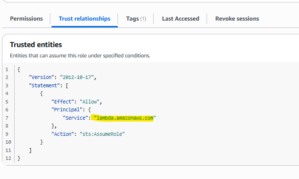

### 2️⃣ Permissões do `salesAnalysisReportRole`
Quatro políticas: acesso ao **SNS**, leitura do **Systems Manager**, logs do **CloudWatch** e permissão para **invocar outra função Lambda**.

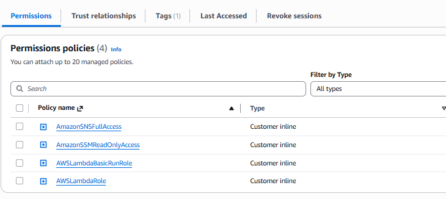

### 3️⃣ Permissões do `salesAnalysisReportDERole`
Duas políticas: logs do **CloudWatch** e acesso de rede a uma **VPC** (`AWSLambdaVPCAccessRunRole`).

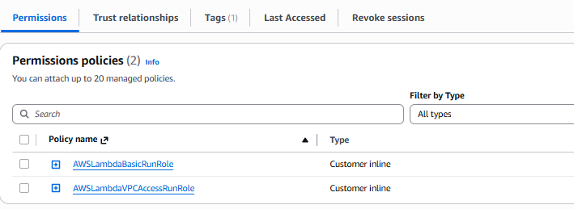

## ⚡ Tarefa 2: Camada e função extratora

### 4️⃣ Camada criada
A camada **`pymysqlLibrary`**, versão 1, com a mensagem de criação bem-sucedida e o runtime compatível.

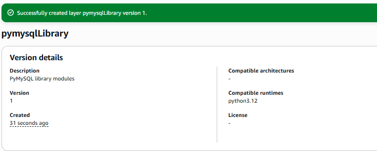

### 5️⃣ Camada adicionada à função
A função `salesAnalysisReportDataExtractor` com **Layers (1)** e a camada `pymysqlLibrary` listada.

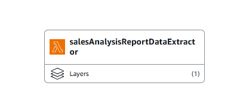

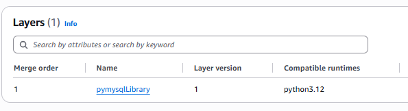

### 6️⃣ Handler e código
O **handler** `salesAnalysisReportDataExtractor.lambda_handler` e o código importado, que recebe `dbUrl`, `dbName`, `dbUser` e `dbPassword` pelo evento e se conecta ao MySQL com PyMySQL.

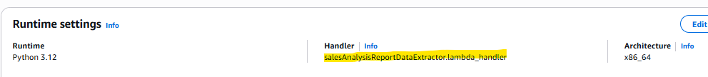

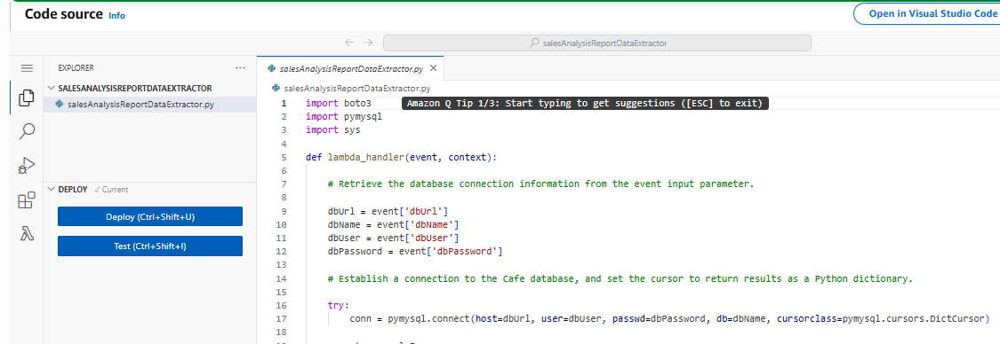

### 7️⃣ Configuração de VPC
A função na **Cafe VPC**, na **Cafe Public Subnet 1** (`us-west-2a`) e com o `CafeSecurityGroup`, para alcançar o banco de dados.

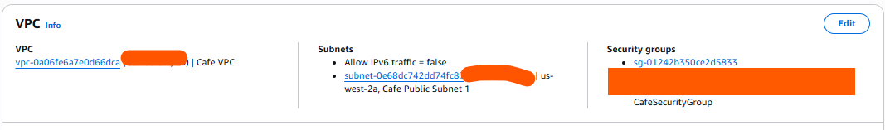

## 🧪 Tarefa 3: Teste e troubleshooting

### 8️⃣ Parâmetros do banco
O Parameter Store com os parâmetros `/cafe/dbUrl`, `/cafe/dbName`, `/cafe/dbUser` e `/cafe/dbPassword`. Os valores não são exibidos.

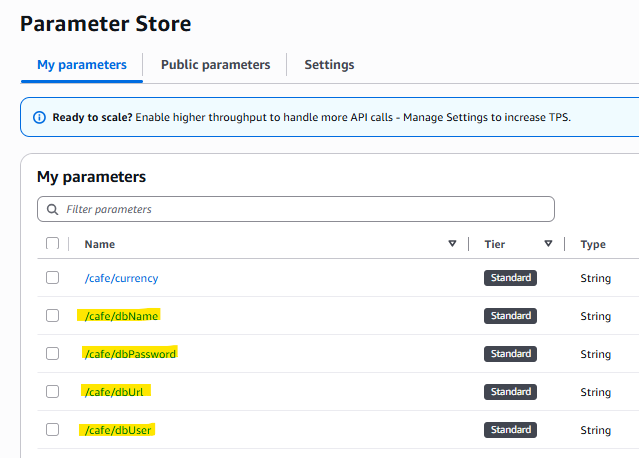

### 9️⃣ Primeiro teste: timeout
O teste falhou com **`Task timed out after 3.00 seconds`**. A função tentava se conectar ao MySQL, mas a conexão nunca se completava.

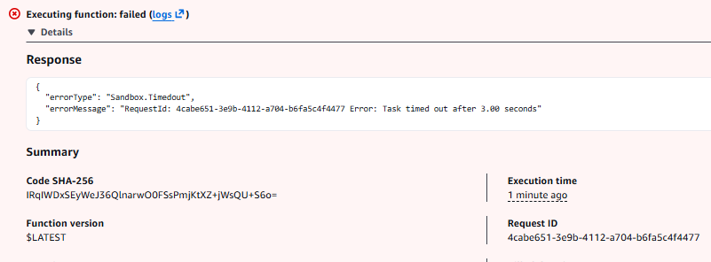

### 🔟 Correção: regra da porta 3306
O `CafeSecurityGroup` ganhou uma regra de entrada **MYSQL/Aurora (TCP 3306)**, com o próprio grupo de segurança como origem, o que libera a conexão apenas entre os recursos que o usam.

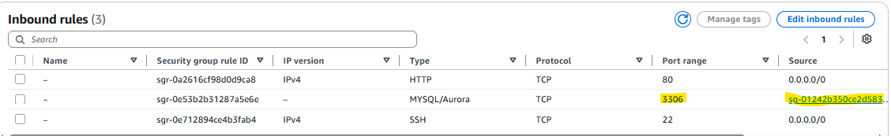

### 1️⃣1️⃣ Teste com sucesso, sem dados
Depois da correção, o teste passou, com `statusCode: 200`. O campo `body` veio **vazio** porque o banco ainda não tinha pedidos.

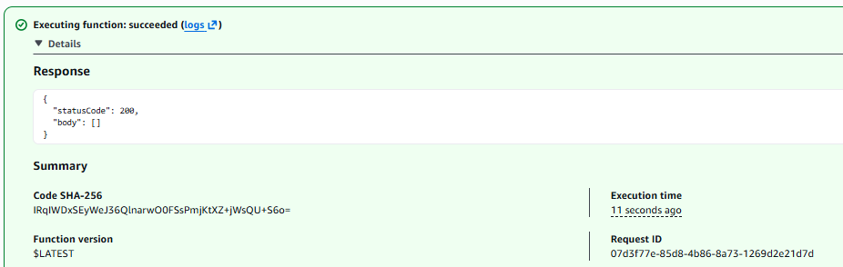

### 1️⃣2️⃣ Pedidos no site da cafeteria
Fiz pedidos pelo site para preencher o banco. A página de confirmação mostra o número do pedido, os itens e o valor total.

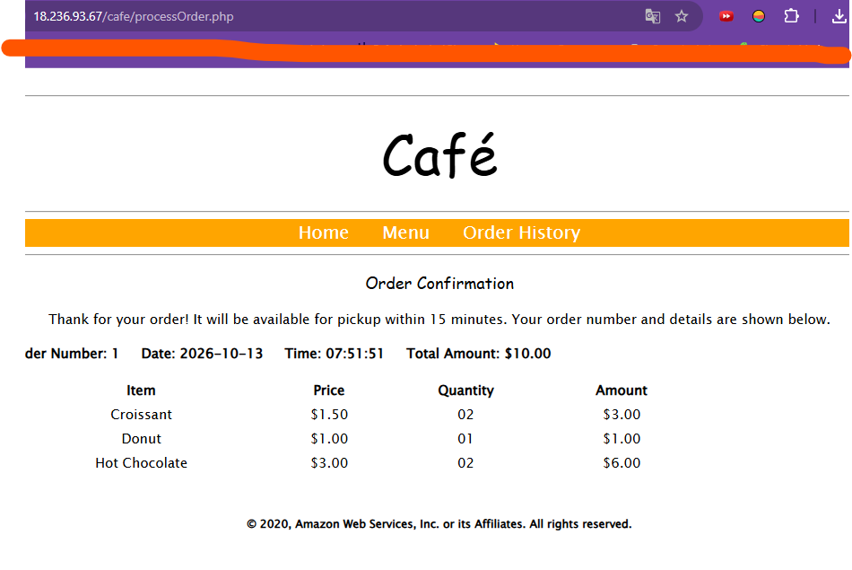

### 1️⃣3️⃣ Teste com sucesso e dados
Agora o `body` traz os produtos e quantidades (por exemplo, **Pastries / Croissant / 2**), comprovando que a função lê o banco.

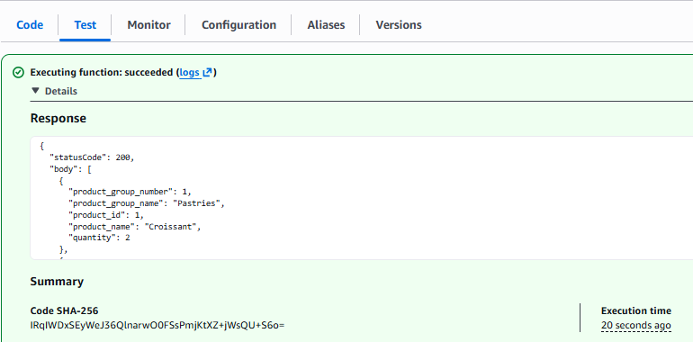

## 📣 Tarefa 4: SNS

### 1️⃣4️⃣ Tópico criado
O tópico **`salesAnalysisReportTopic`**, tipo **Standard**, com o nome de exibição `SARTopic`.

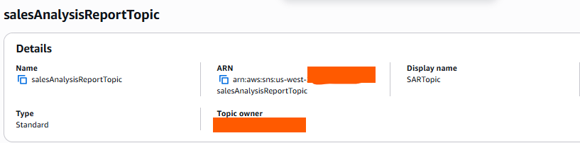

### 1️⃣5️⃣ Assinatura confirmada
A assinatura por **e-mail** com o status **Confirmed**.

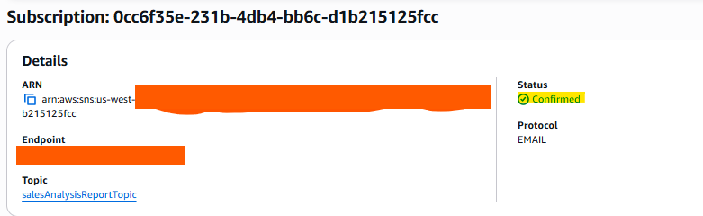

## 📊 Tarefa 5: Função do relatório

### 1️⃣6️⃣ AWS CLI configurada
A AWS CLI configurada no **CLI Host** (região `us-west-2`, formato `json`).

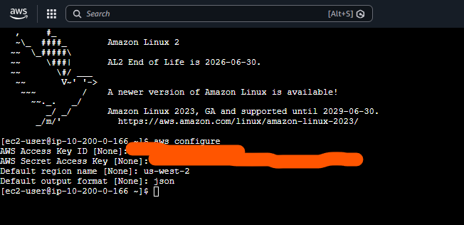

### 1️⃣7️⃣ Função criada pela CLI
O comando `aws lambda create-function` retornou os atributos da função `salesAnalysisReport`: handler, runtime, memória e estado **Pending** (em criação).

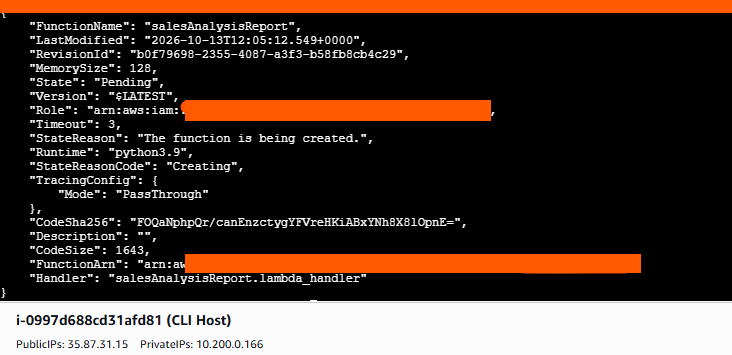

### 1️⃣8️⃣ Variável de ambiente
A variável **`topicARN`** com o ARN do tópico SNS.

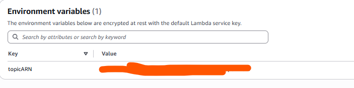

### 1️⃣9️⃣ Erro de endpoint do SNS
O primeiro teste falhou com **`Invalid endpoint: https://sns..amazonaws.com`**: a região do endpoint estava **vazia**. A função lê a região do próprio ARN do tópico, e o valor da variável `topicARN` estava incorreto.

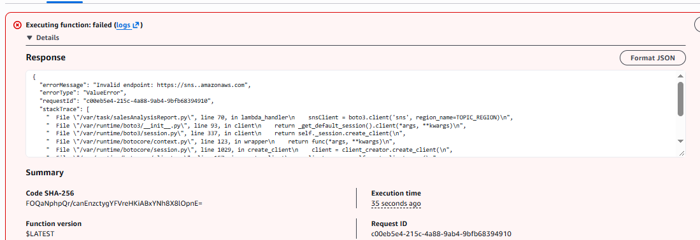

### 2️⃣0️⃣ Teste com sucesso
Depois de corrigir o ARN na variável `topicARN`, o teste passou e retornou **`Sale Analysis Report sent.`**

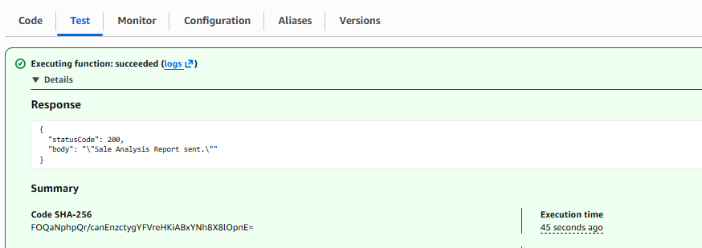

### 2️⃣1️⃣ E-mail com o relatório de vendas
O e-mail **Daily Sales Analysis Report**, enviado pelo tópico `SARTopic`, com os itens vendidos agrupados por categoria.

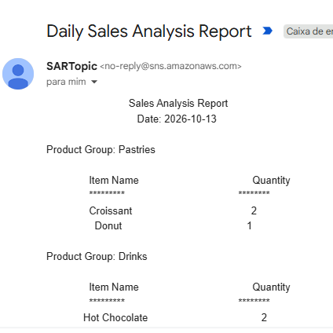

### 2️⃣2️⃣ Gatilho do EventBridge
A função `salesAnalysisReport` com o **EventBridge** conectado como gatilho.

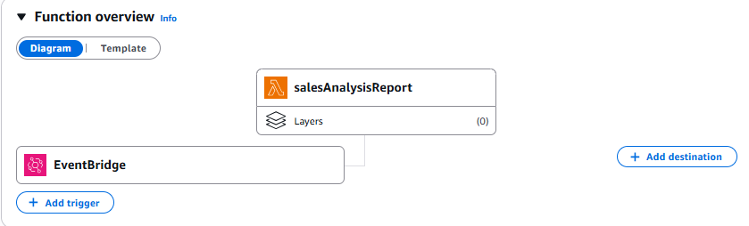

### 2️⃣3️⃣ E-mail disparado pela agenda
Um novo e-mail do relatório, agora disparado **automaticamente** pela regra do EventBridge, com os dados atualizados dos pedidos.

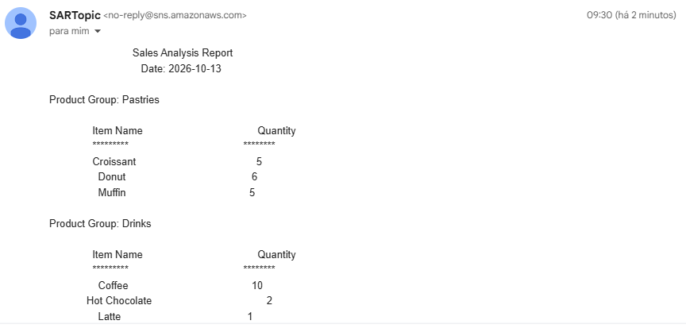

---

## 🐞 Dificuldades encontradas

| 🔴 Erro | 🔍 Causa | ✅ Solução |
|---|---|---|
| `Task timed out after 3.00 seconds` na função extratora | O grupo de segurança não permitia a porta **3306** do MySQL, então a conexão com o banco nunca se completava | Adicionar uma regra de entrada **MYSQL/Aurora (3306)**, com o próprio `CafeSecurityGroup` como origem |
| `Invalid endpoint: https://sns..amazonaws.com` na função do relatório | O ARN do tópico na variável `topicARN` estava incorreto, e a **região** (lida do ARN) ficou vazia | Copiar o ARN completo do tópico SNS e colá-lo na variável `topicARN` |
| `body` vazio no resultado da extratora | O banco de dados ainda não tinha pedidos | Fazer pedidos no site da cafeteria e testar de novo |

---

## 🧠 Aprendizados

- 🔐 Cada função Lambda precisa de um **perfil IAM** com a relação de confiança e as permissões certas
- 🧩 **Camadas** permitem reutilizar bibliotecas sem incluí-las no pacote de cada função
- 🛡️ Uma função Lambda em uma **VPC** depende das regras do **Security Group** para alcançar outros recursos
- ⏱️ Um *timeout* de conexão muitas vezes indica **bloqueio de rede**, e não erro de código
- 🧭 Ler a **pilha de erros** ajuda: o erro `sns..amazonaws.com` apontou para uma região vazia e levou direto à variável incorreta
- 🔑 O **Parameter Store** guarda configurações e credenciais fora do código
- 🔗 Uma função pode **invocar outra**, montando um fluxo em etapas
- ⏰ O **EventBridge** agenda execuções com **cron**, sempre em **UTC**
- 📣 O SNS só entrega e-mail depois que a assinatura é **confirmada**

---

## 🔐 Observação sobre os prints

> ⚠️ Os recursos que aparecem nas imagens pertencem a um **ambiente temporário de laboratório**, já encerrado. IDs de conta, ARNs, credenciais e endereços de e-mail foram cobertos. Em projetos reais, evite publicar IDs de conta, ARNs, endereços de e-mail e chaves de acesso.

---

### 👩‍💻 Autora

**LUCIANA RB DE ASSIS**

⭐ Se este projeto foi útil, deixe uma estrela no repositório!

